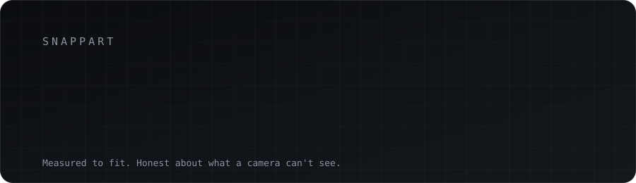
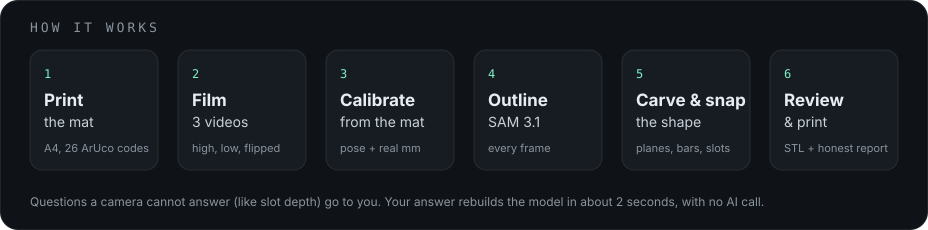

<div align="center">



<br>

**Film a part on a printed mat. Get a measured, printable STL and an honest report.**

<br>


[How it works](#how-it-works) ·
[Real results](#real-results) ·
[Honest labels](#honest-labels) ·
[Meta models](#meta-models) ·
[Run it](#run-it) ·
[Open source](#built-with-open-source)

</div>

<br>

## Why

A cracked latch on a toolbox, a snapped bracket under a favourite toy car, a hinge nobody sells any more. The part is small, the thing it belongs to is not. SnapPart turns a few short phone videos of the part into a model you can print, **measured to fit**, and it tells you where it is sure and where it needs your number.

Most tools make a model that *looks* right. SnapPart makes one that is *measured*, and says plainly what it could not see.

## How it works

<div align="center">

</div>

1. **Print the mat.** An A4 sheet of 26 ArUco codes (`DICT_4X4_50`, 22.0 mm). Get it in [`frontend/public/snappart_mat_A4.pdf`](frontend/public/snappart_mat_A4.pdf).
2. **Film three short videos.** A high orbit, a low orbit, and one with the part flipped over.
3. **Calibrate from the mat.** Every frame gets its camera position and real millimetre scale from the codes. A joint adjustment copes with a mat that is not perfectly flat.
4. **Outline with SAM 3.1.** The part is cut out of every frame, and the edge is refined where colour is decisive.
5. **Carve and snap.** Outlines carve a voxel model. Flat faces and round bars are snapped true. Slots, ridges and plates are found from the views.
6. **Review and print.** Anything a camera cannot see (how deep a slot goes) becomes a "show me where" question. Your answer rebuilds the model in about 2 seconds, with no AI call. Download the STL.

## Real results

One test part so far: a briefcase lock plate, **51.6 × 41.9 × 11.8 mm by calipers**, filmed in three videos.

| Quantity | SnapPart | Calipers | Error |
| --- | --- | --- | --- |
| Length | 51.34 mm | 51.6 mm | −0.26 mm |
| Width | 41.70 mm | 41.9 mm | −0.20 mm |
| Height | 11.69 mm | 11.8 mm | −0.11 mm |
| Slot opening (4 found) | 7.43 × 2.54 mm | 7.4 × 2.6 mm | +0.03 / −0.06 mm |
| Held-out silhouette score | **0.95** | n/a | n/a |

The held-out score measures how well the model matches photos it never used to build it. The printed copy fit the real lock; the mechanism worked after light sanding. It printed 1–2 mm short in length, which we are still tracing (printer and slicer calibration are the likely cause).

**This is one part.** It is not an accuracy claim for other parts, other light or a mat that lies badly. Method, tables, known limits and an unresolved plate-thickness conflict are written out in [`docs/accuracy.md`](docs/accuracy.md).

## Honest labels

Every value in a report carries one of four labels, so you always know what to trust.

| Label | Meaning |
| --- | --- |
| **Measured** | Taken from many views and the mat's scale. |
| **You entered** | Something a camera cannot see. You typed the number when asked. |
| **Estimated** | Used only when you skip a question. Always labelled. |
| **Can't be seen** | Hollows, blind pockets, the underside without the flipped video, anything under about 1 mm. |

A Meta model is shown as *running* only when it runs in the build you are looking at.

## Meta models

All calls go through the Meta Model API with the standard (not "contributor") model IDs.

| Model | Job | State in this repo |
| --- | --- | --- |
| `sam-3.1` | Outlines the part in every video frame | **Running** in the test runs (`backend/spikes/`); `backend/capture/masks.py` refines its outlines. Moves into the job API next. |
| `muse-spark-1.3` | Checks videos, writes questions, turns spoken or typed corrections into changes, writes the report | Early spikes only (`backend/spikes/`). Not yet in the pipeline. |
| `muse-voice-transcribe-1.0` | Turns spoken answers into text | Planned. Not yet integrated. |

This table is updated when each model is actually wired in, not before.

## Project status

| Part | State |
| --- | --- |
| Capture pipeline (mat, calibration, outlines, carve, snap, features, review, corrections) | Working on one test part |
| Printed-part check | Fits the real lock |
| Design | Approved prototype in [`docs/design/approved/`](docs/design/approved) |
| Backend job API (upload, progress, answers, resume) | In progress |
| Web app wired to the backend | In progress |
| Muse Spark and Muse Voice in the app | Planned |
| Second-part test | Planned |

## Run it

Backend (conda):

```bash
conda env create -f backend/environment.yml
conda activate snappart
cp .env.example .env        # add your own MODEL_API_KEY. Never commit .env
pytest backend/tests
```

Frontend:

```bash
cd frontend
npm install
npm run dev
```

The golden test needs private test videos that are not in this repository. Setup for the full app will be added when the job API lands.

## Built during the hackathon

Everything here was written during the hackathon window. The history starts on Oct 26, 2026 (IST) with the initial commit and no code from before kickoff is included. The Meta Global AI Developer Hackathon ran Oct 26 to Nov 4, 2026.

## Built with open source

| Software | Licence |
| --- | --- |
| [OpenCV](https://opencv.org) (`opencv-python-headless`) | Apache-2.0 |
| [NumPy](https://numpy.org), [SciPy](https://scipy.org), [scikit-image](https://scikit-image.org) | BSD-3-Clause |
| [CadQuery](https://github.com/CadQuery/cadquery) | Apache-2.0 |
| [FastAPI](https://fastapi.tiangolo.com), [Pydantic](https://docs.pydantic.dev) | MIT |
| [Uvicorn](https://www.uvicorn.org), [httpx](https://www.python-httpx.org) | BSD-3-Clause |
| [React](https://react.dev), [Vite](https://vite.dev), [Tailwind CSS](https://tailwindcss.com) | MIT |
| [three.js](https://threejs.org) (3D viewer) | MIT |
| [Geist](https://vercel.com/font) (typeface) | SIL OFL 1.1 |

Exact versions are pinned in `backend/environment.yml` and `frontend/package-lock.json`.

## Privacy

No login. Your part gets a private link and a resume code. The Meta API key stays on the server and never reaches the browser. Private test photos and videos used during development are not in this repository.

## Credits

Made by **[Bibek Sarkar](https://github.com/bibeksarkar001)**, with help from **Bhashwati Roy** on measurements and testing.

## License

[MIT](LICENSE)
