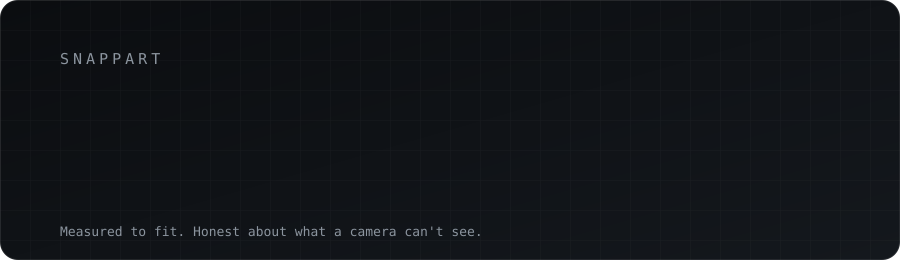
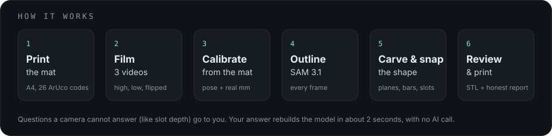

<div align="center">



<br>

**Film a part on a printed mat. Get a measured, printable STL and an honest report.**

<br>


[How it works](#how-it-works) ·
[Real results](#real-results) ·
[Honest labels](#honest-labels) ·
[Meta models](#meta-models) ·
[Try it](#try-it-in-two-minutes) ·
[Run it](#run-it) ·
[Open source](#built-with-open-source)

</div>

<br>

## Why

A cracked latch on a toolbox, a snapped bracket under a favourite toy car, a hinge nobody sells any more. The part is small, the thing it belongs to is not. SnapPart turns a few short phone videos of the part into a model you can print, **measured to fit**, and it tells you where it is sure and where it needs your number.

Most tools make a model that *looks* right. SnapPart makes one that is *measured*, and says plainly what it could not see.

## How it works

<div align="center">

</div>

1. **Print the mat.** An A4 sheet of 26 ArUco codes (`DICT_4X4_50`, 22.0 mm). Get it in [`frontend/public/snappart_mat_A4.pdf`](frontend/public/snappart_mat_A4.pdf).
2. **Film three short videos.** A high orbit, a low orbit, and one with the part flipped over.
3. **Calibrate from the mat.** Every frame gets its camera position and real millimetre scale from the codes. A joint adjustment copes with a mat that is not perfectly flat.
4. **Outline with SAM 3.1.** The part is cut out of every frame, and the edge is refined where colour is decisive.
5. **Carve and snap.** Outlines carve a voxel model. Flat faces and round bars are snapped true. Slots, ridges and plates are found from the views.
6. **Review and print.** Anything a camera cannot see (how deep a slot goes) becomes a "show me where" question. Your answer rebuilds the model in about 2 seconds, with no AI call. Download the STL.

### Fix the model yourself

Every change is an edit you can see, with its size in millimetres, and you can undo it.

- **Remove a feature that is not on your part.** Press "Remove the 2 slots", or say "there is no hole, it is a screw". Muse Spark turns the sentence into one typed edit and you confirm it.
- **Mark a spot with a circle.** Click the model, set the radius (1 to 20 mm) and how deep Remove cuts (0.5 to 15 mm). An amber ring shows exactly what will change. Works on sides and tops.
- **Speak it.** Muse Voice Transcribe turns a recording into text on the first screen and in Review. The audio is not kept.
- **Undo.** "Your changes" lists every edit with an Undo button.
- The model never writes geometry or code: Spark only picks from a short list of typed actions, the engine checks every number, and nothing changes until you confirm.

## Real results

One test part so far: a briefcase lock plate, **51.6 × 41.9 × 11.8 mm by calipers**, filmed in three videos.

| Quantity | SnapPart | Calipers | Error |
| --- | --- | --- | --- |
| Length | 51.34 mm | 51.6 mm | −0.26 mm |
| Width | 41.70 mm | 41.9 mm | −0.20 mm |
| Height | 11.69 mm | 11.8 mm | −0.11 mm |
| Slot opening (4 found) | 7.43 × 2.54 mm | 7.4 × 2.6 mm | +0.03 / −0.06 mm |
| Held-out silhouette score | **0.95** | n/a | n/a |

The held-out score measures how well the model matches photos it never used to build it. The printed copy fit the real lock; the mechanism worked after light sanding. It printed 1–2 mm short in length, which we are still tracing (printer and slicer calibration are the likely cause).

**This is one part.** It is not an accuracy claim for other parts, other light or a mat that lies badly. Method, tables, known limits and an unresolved plate-thickness conflict are written out in [`docs/accuracy.md`](docs/accuracy.md).

### Test results, honest summary

We have measured 8 parts with calipers so far. The full write-up, including the failures, is in [`testing/`](testing/README.md).

- Width or diameter is within about 1 mm for 4 parts (2, 3, 6 and 7).
- Length and height are not yet reliable. Several parts are off by tens of millimetres, and thin plates come out too tall. This is the next thing to fix.
- Slots and groove depths are detected and cut from your answers. When a detected slot is not on the real part, you can remove it in Review. Features the video cannot see stay "detected, not in model".
- Footage matters most. Three different, slow, full-circle videos work. The app refuses a clip that repeats another or that does not go round the part. One live run of part 8 from a weak set of videos gave a length 7 mm too long; that is not fixed yet.
- Parts 9 to 15 have app results but no caliper check yet.


## Honest labels

Every value in a report carries one of four labels, so you always know what to trust.

| Label | Meaning |
| --- | --- |
| **Measured** | Taken from many views and the mat's scale. |
| **You entered** | Something a camera cannot see. You typed the number when asked. |
| **Estimated** | Used only when you skip a question. Always labelled. |
| **Can't be seen** | Hollows, blind pockets, the underside without the flipped video, anything under about 1 mm. |

A Meta model is shown as *running* only when it runs in the build you are looking at.

## Meta models

All calls go through the Meta Model API with the standard (not "contributor") model IDs.

| Model | Job | Called from | State in this repo |
| --- | --- | --- | --- |
| `sam-3.1` | Outlines the part in every video frame | `backend/capture/sam.py` (`adapter`) through `backend/app/meta_client.py` (`MetaClient.segment`); `backend/capture/masks.py` refines the outlines | **Running** in the recorded part B run of 2026-10-31 (UTC): 220 calls, all OK, in [`examples/recorded/part_b/meta_calls.jsonl`](examples/recorded/part_b/meta_calls.jsonl). |
| `muse-spark-1.3` | Second opinion on the footage, friendlier question wording, typed or spoken corrections turned into proposed changes, plain-language summary | `backend/app/spark.py` (`capture_opinion`, `word_question`, `propose`, `summarize`) through `MetaClient.chat_json` | **Running** in the same recorded run: 11 calls, all OK (footage second opinion, question wording, the summary before and after the owner's answers, and reading one spoken answer). Typed corrections have no recorded call yet. Each job falls back to plain rules when the model is not available, and says so. |
| `muse-voice-transcribe-1.0` | Turns spoken corrections into text | `backend/app/voice.py` (`to_wav`) and `MetaClient.transcribe`, from `POST /v1/jobs/{id}/voice` | **Running** in the same recorded run: 1 call, OK (one spoken answer to the open slot-depth question; the audio is not stored). |

A model is marked as running only where a recorded call exists. `GET /v1/meta/models` reports this from the calls the server actually made.

## Project status

| Part | State |
| --- | --- |
| Capture pipeline (mat, calibration, outlines, carve, snap, features, review, corrections) | Working. Checked by calipers on 8 parts; heights and lengths not yet reliable ([`testing/`](testing/README.md)) |
| Printed-part check | Fits the real lock |
| Design | Approved prototype in [`docs/design/approved/`](docs/design/approved) |
| Backend job API (upload, checks, queue, progress, answers, corrections, review, resume, delete) | Built and tested with the mock pipeline and a fake Meta server ([`docs/api.md`](docs/api.md), [`docs/load-test.md`](docs/load-test.md)) |
| Web app wired to the backend | Working end to end: prepare, capture, build, review, result, in recorded mode and live mode |
| Muse Spark and Muse Voice in the API | Wired (see the table above) |
| Test set (15 parts) | 8 parts checked with calipers. Parts 9 to 15 have app results only ([`testing/`](testing/README.md)) |

## Try it in two minutes

No key, no cost: the app plays back a real recorded run of part B, labelled "recorded run" everywhere, and you can still turn the model, mark spots, answer questions and download the STL.

```bash
cd backend && uvicorn app.main:app --port 8000     # terminal 1
python -m app.worker                               # terminal 2
cd frontend && npm install && npm run dev          # terminal 3, then open https://localhost:5173
```

Or one command for everything, live and recorded side by side (needs the conda env; add your key to `.env` for the live side):

```bash
scripts/dev.sh
```

The header switch (**Live ⇄ Recorded**, shown in development builds) flips between a real build and the recording. Without a key only the recording works. With your own `MODEL_API_KEY` in `.env`, real builds call SAM 3.1, Muse Spark and Muse Voice Transcribe. The dev server listens on localhost only; `SNAPPART_LAN=1` opens it to your network, and then anyone there can spend your key.

## Run it

Backend (conda):

```bash
PIP_NO_DEPS=1 conda env create -f backend/environment.yml
conda activate snappart
cp .env.example .env        # optional: add your own MODEL_API_KEY. Never commit .env
pytest backend/tests
```

`PIP_NO_DEPS=1` keeps pip to the exact versions pinned in `environment.yml`. Without it, pip's `opencv-python-headless` pulls in numpy 2, which breaks the conda-built scikit-image. The pipeline is tested on numpy 1.26.4.

Start the API and one worker (from `backend/`):

```bash
uvicorn app.main:app --port 8000
```

```bash
python -m app.worker
```

- **No key (default): replay mode.** The API serves the recorded real run of part B in [`examples/recorded/part_b/`](examples/recorded/part_b). [What is replayed and what runs live](examples/recorded/README.md). Every response is labelled "recorded run" with its date, and no Meta model is called. The API prints this when it starts.
- **`SNAPPART_MOCK=1`: mock mode.** A canned synthetic part, labelled mock.
- **Your own `MODEL_API_KEY` in `.env`: live mode.** Real builds call SAM 3.1 and Muse Spark with your key. Details are in [`docs/ops.md`](docs/ops.md) and [`docs/api.md`](docs/api.md).

Frontend:

```bash
cd frontend
npm install
npm run dev
```

Before you commit, run `scripts/precommit_check.sh`. It lists what would go to GitHub and flags env files, private test data, big files, keys and unfilled placeholders. It changes nothing.

Deploy with Docker (not yet run on a real host; see [`docs/ops.md`](docs/ops.md)): `cd frontend && npm run build`, put your certificate in `deploy/tls/`, set `server_name` in `deploy/nginx.conf`, then `docker compose up --build`. nginx serves the built frontend and proxies `/v1`. The image carries the recorded run, so a server with no key still shows the demo. `SNAPPART_DAILY_BUDGET_CALLS` (default 2000, about 9 builds) caps what a key can spend per day.

The golden test needs private test files that are not in this repository; without them it is skipped.

## Built during the hackathon

Everything here was written during the hackathon window. The history starts on Oct 26, 2026 (IST) with the initial commit and no code from before kickoff is included. The Meta Global AI Developer Hackathon ran Oct 26 to Nov 4, 2026.

## Built with open source

| Software | Licence |
| --- | --- |
| [OpenCV](https://opencv.org) (`opencv-python-headless`) | Apache-2.0 |
| [NumPy](https://numpy.org), [SciPy](https://scipy.org), [scikit-image](https://scikit-image.org) | BSD-3-Clause |
| [CadQuery](https://github.com/CadQuery/cadquery) | Apache-2.0 |
| [FastAPI](https://fastapi.tiangolo.com), [Pydantic](https://docs.pydantic.dev) | MIT |
| [Uvicorn](https://www.uvicorn.org), [httpx](https://www.python-httpx.org) | BSD-3-Clause |
| [React](https://react.dev), [Vite](https://vite.dev), [Tailwind CSS](https://tailwindcss.com) | MIT |
| [Geist](https://vercel.com/font) (typeface, used by the design prototype in `docs/design/approved/`) | SIL OFL 1.1 |
| [meta-sam-parser](https://pypi.org/project/meta-sam-parser/) (reads SAM 3.1 results) | SAM License, **not an open-source licence**: [`third_party/meta-sam-parser/LICENSE`](third_party/meta-sam-parser/LICENSE) |
| [FFmpeg](https://ffmpeg.org) | GPL-2.0-or-later. Installed by conda as a dependency of VTK, and used for voice conversion only if present. It is not redistributed by this repository. |

Exact versions are pinned in `backend/environment.yml` and `frontend/package-lock.json`. Every Python and native package with its licence is listed in [`docs/licences.md`](docs/licences.md).

## Privacy

No login. Your part gets a private link and a resume code. The Meta API key stays on the server and never reaches the browser. Private test photos and videos used during development are not in this repository.

## Credits

Made by **[Bibek Sarkar](https://github.com/bibeksarkar001)**, with help from **Bhashwati Roy** on measurements and testing.

## License

[MIT](LICENSE)
